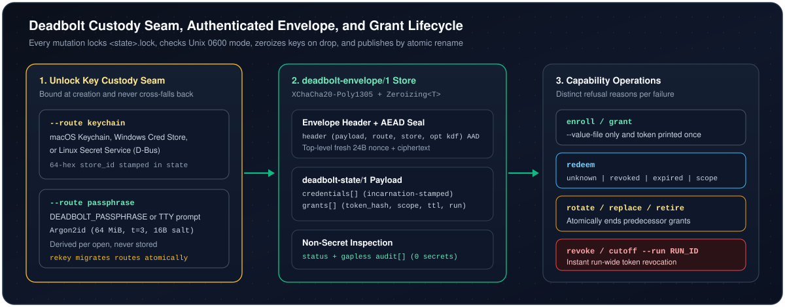

# Deadbolt Operator and Credential Custody Guide

Deadbolt is an encrypted local secrets broker for autonomous agent workflows. Instead of placing raw API keys or cloud tokens inside an agent's environment or prompt context, an operator enrolls each secret once into a sealed `deadbolt` store, mints short-lived capability tokens scoped to a single `resource` and `action`, and redeems those tokens only inside approved tool subprocesses.



## 1. Custody routes and envelope encryption

Every `deadbolt` store is sealed on disk inside a `deadbolt-envelope/1` envelope encrypted with `XChaCha20-Poly1305` under a fresh 24-byte random nonce on every write, with the envelope header authenticated as additional data (`AAD`). On Unix systems, the state file is created with mode `0600` (owner read and write only), and Deadbolt refuses to open any store whose permissions grant group or world access.

Choose one of two key custody routes when creating a store (`--route keychain` or `--route passphrase`).

| Custody route | How the 32-byte store key is held | Best suited for |
| --- | --- | --- |
| `keychain` | Stored in macOS Keychain, Windows Credential Manager, or Linux Secret Service (`libdbus-1`) keyed by a random 64-hex store identifier | Developer workstations and desktop agent hosts with an unlocked login keyring |
| `passphrase` | Derived per invocation with `Argon2id` (`64 MiB`, `3` iterations) over a fresh 16-byte salt from `DEADBOLT_PASSPHRASE` (or an echo-disabled TTY prompt) and zeroized on drop | Headless Linux servers, CI runners, and containers without a D-Bus keyring daemon |

The `--route` option is supplied only on the command that creates a new store (or adopts a legacy unsealed store). Subsequent commands read the custody route directly from the authenticated envelope header.

## 2. Enrolling credentials and designing scopes

Credential values enter Deadbolt exclusively through `--value-file` (never on the command line where process tables or shell history would expose them). Each scope pairs a safe `resource` name and `action` name separated by a colon on the CLI, and a grant can request only a scope carried by the enrolled credential.

```sh
export DEADBOLT_PASSPHRASE='SYNTHETIC-TEST-VALUE-passphrase'
printf '%s\n' 'SYNTHETIC-TEST-VALUE-storage-key' > storage-key.txt
deadbolt --state vault.json --route passphrase enroll \
  --name storage-api \
  --value-file storage-key.txt \
  --scope artifacts:read \
  --scope artifacts:write
rm -f storage-key.txt
```

## 3. Minting grants and injecting secrets without leaks

Mint a short-lived capability token (`1` to `86400` seconds) tagged with `--run RUN_ID` so an entire agent run's active tokens can be cut off in one command if the run misbehaves. Deadbolt prints the raw capability token once in the grant receipt and stores only its `SHA-256` digest in the state file.

```sh
GRANT_RECEIPT=$(deadbolt --state vault.json grant \
  --credential storage-api \
  --scope artifacts:read \
  --ttl 300 \
  --run run-42)
GRANT_TOKEN=$(printf '%s' "$GRANT_RECEIPT" | python3 -c 'import json, sys; print(json.load(sys.stdin)["token"])')
```

Use the bundled standard-library helper `examples/redeem_wrapper.py` to redeem a token and inject the secret into one child command's environment variable while automatically stripping `DEADBOLT_TOKEN`, `DEADBOLT_PASSPHRASE`, and `DEADBOLT_NEW_PASSPHRASE` before the child executes.

```sh
DEADBOLT_PASSPHRASE='SYNTHETIC-TEST-VALUE-passphrase' \
DEADBOLT_TOKEN="$GRANT_TOKEN" \
  python3 examples/redeem_wrapper.py \
  --state vault.json \
  --scope artifacts:read \
  --env-var STORAGE_TOKEN \
  -- /bin/sh -c 'test -n "$STORAGE_TOKEN"'
```

## 4. Non-secret status, rotation, rekey, and emergency cutoff

- **Inspect store health (`status`)** to read a JSON summary of the custody route, store identifier, enrolled credential metadata, per-grant summaries (each carrying `live`, `expired`, or `revoked` status), and the `audit_entries` count without touching the sealed store file on disk or exposing any secret value, token, or token hash.
- **Cut off a run (`cutoff --run RUN_ID`)** or **revoke one grant (`revoke --grant GRANT_ID`)** to end active grants immediately.
- **Rotate, replace, or retire credentials** with `rotate` (enrolls a successor under a new name, ends every live grant on the predecessor, and removes the predecessor atomically), `replace` (updates the value and scopes in place under the same name at `incarnation + 1` and ends every live grant on the old incarnation), or `retire` (removes the credential and ends every live grant).
- **Rekey a store (`rekey --to-route ...`)** to rotate passphrases (via `DEADBOLT_NEW_PASSPHRASE`) or migrate atomically between `passphrase` and `keychain` custody with in-memory round-trip verification before atomic rename.

## 5. Running the bundled quickstarters

Build the `deadbolt` binary and run both quickstarters (`examples/quickstart.rs` and `examples/broker_walkthrough.py`) from a local checkout. Neither prints any secret value or leaves files outside its temporary directory.

```sh
cargo build --bin deadbolt
cargo run --example quickstart
python3 examples/broker_walkthrough.py
```

## 6. Optional composition with sibling tools

Deadbolt has zero dependency on any sibling crate or package, and deliberately ships no Python C-extension so secret bytes do not linger in a long-lived interpreter heap. When paired with `portcullis`, `arvin`, and `mayfly`, `portcullis` approves the tool call first, `deadbolt` redeems the scoped secret through `examples/redeem_wrapper.py` into `mayfly run --allow-env`, and `arvin` triggers `deadbolt cutoff --run RUN_ID` whenever a run escalates to `cut budget` or `kill`.
